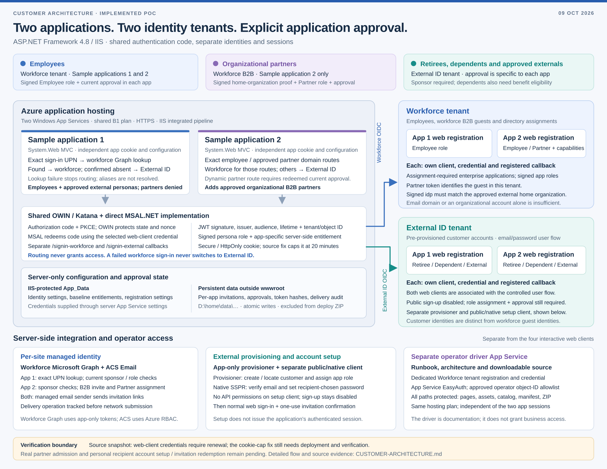

# Web application with two IdP authorities

Documentation snapshot: **9 October 2026**. This document describes the implemented **ASP.NET Framework 4.8 / IIS PoC**, its deployment scripts and its security boundaries. It does not attest to the current state of live resources. The separate ASP.NET Core sample in this repository is outside this diagram's scope.

[Open the full-resolution vector image](customer-architecture.svg) or [download the presentation-ready PNG](customer-architecture.png).

Only the generic labels **Workforce tenant** and **External ID tenant** are used. Deployment identifiers, hostnames, credentials, recipient details and real approval records are deliberately excluded.

## Deployment and identity topology

The deployment uses two Windows Azure App Services running System.Web MVC on .NET Framework 4.8 and IIS, plus a third App Service for the operator driver. The infrastructure script places the three sites on a shared B1 App Service plan with HTTPS, a minimum TLS version of 1.2 and Always On. The sample applications use OWIN authentication inside the application; the driver has a separate App Service EasyAuth boundary. A shared plan is a PoC hosting choice, not evidence of high availability or isolation equivalent to separate infrastructure.

| Component | Implemented responsibility | Identity and isolation |
|---|---|---|
| Sample application 1 | Employee access and approved retiree, dependent or other external access | Independent configuration, application cookie, callbacks and two confidential web clients |
| Sample application 2 | The same populations, plus approved organizational B2B partners | Its own configuration, cookie, callbacks and two different confidential web clients |
| Workforce tenant | Employee identities, workforce B2B guest objects, workforce app roles and assignments | Separate web registration and enterprise application for each sample app |
| External ID tenant | Pre-provisioned customer identities and controlled email/password flow | Separate web registration and enterprise application for each sample app; public sign-up disabled |
| Runtime integrations | Workforce directory operations and invitation delivery | One managed identity per sample site; external provisioning uses a separate app-only client credential |
| Account setup | Email verification and recipient-chosen password for an invited customer | Separate public/native registration associated with the controlled External ID flow; no API permissions |
| Operator driver | Runbook, architecture, code catalog and source downloads | Separate workforce registration and credential; EasyAuth restricts every path to the configured operator object ID |

The four interactive web registrations are single-tenant clients: two in Workforce tenant and two in External ID tenant. Each has its own client credential and the exact callback for its application origin. The workforce callback path is `/signin-workforce`; the customer callback path is `/signin-external`. Interactive clients request identity scopes (`openid profile email`); they do not inherit the provisioning clients' directory permissions.

Sources: [infrastructure](../scripts/poc/Initialize-PocInfrastructure.ps1), [web registrations](../scripts/poc/Configure-PocApplications.ps1), [deployment packaging](../scripts/poc/Deploy-PocSites.ps1), [driver protection](../scripts/poc/Secure-PocDriver.ps1), [IIS configuration](../samples/net48/sampleapp01/web.config).

## Routing, authentication and business admission

The user enters a sign-in address into the selected application. The address selects an identity path; it grants no access by itself.

| Population / routing case | Sample application 1 | Sample application 2 |
|---|---|---|
| Employee | Exact entered sign-in UPN is found in workforce Microsoft Graph; use Workforce tenant | Exact configured employee domain routes to Workforce tenant |
| Organizational partner | Partner admission is denied, even when the entered UPN resolves to a workforce object | Configured partner domain, or a domain backed by a redeemed current partner approval, routes to Workforce tenant; actual admission still requires signed B2B evidence |
| Approved customer identity | Confirmed zero exact-UPN workforce matches routes to External ID tenant | Other valid domains route to External ID tenant |
| Ambiguous, unavailable or malformed workforce lookup | Stop with a routing error; do not treat failure as absence | No Graph lookup is required for the domain routing decision |
| Workforce authentication fails | The selected provider does not change | The selected provider does not change |

Sample application 1 queries the workforce directory by **exact `userPrincipalName`**, not mail aliases, `proxyAddresses` or domain inference. A disabled account or guest that matches still belongs to the workforce routing path; authentication and admission decide whether it can enter. Sample application 2 uses exact domain matches rather than suffix/subdomain matching. A new dynamic partner-domain route requires a redeemed, current approval; domain discovery alone does not activate it.

After routing:

1. OWIN / Katana starts authorization-code flow with PKCE and protected state and nonce. The browser completes identity-provider authentication, and the selected provider posts its response to the matching callback.
2. The custom OWIN handler calls **MSAL.NET directly** to redeem the authorization code using the recovered PKCE verifier and the selected web client's credential. The token response returns to Katana's normal validation pipeline; custom code does not bypass nonce validation with `HandleCodeRedemption`.
3. The strict JWT handler requires a signed token and signing-key validation. The pipeline validates the configured exact issuer, audience, lifetime and expected identity source; application admission also checks the issuing tenant ID and stable object ID.
4. The application requires the signed directory persona role and a unique, current server-side entitlement keyed by **application + issuing tenant ID + object ID**. An email address, display name, invitation link or self-declared registration field cannot replace those checks.
5. Approved ordinary access receives the selected app's own Secure, HttpOnly, host-only, SameSite=Lax cookie. The corrected source sets `UseTokenLifetime=false` and a fixed 20-minute lifetime without sliding renewal. The previously deployed source omitted this option, allowing Katana to use the ID-token expiry instead of the intended cookie cap; the corrected cap requires deployment and live verification before it is claimed as deployed behavior. The restricted registration-only cookie already has an explicit cap and was not affected. Tokens are not saved in this cookie, logs or rendered pages. Local logout is an antiforgery-protected POST and clears that application's cookie; the provider's SSO session may remain.

Sources: [routing and runtime services](../samples/net48/Shared/RegistrationServices.cs), [exact-UPN resolver](../samples/net48/Shared/WorkforceAccountResolver.cs), [OWIN startup](../samples/net48/Shared/Startup.cs), [MSAL code redemption](../samples/net48/Shared/MsalOpenIdConnect.cs), [strict JWT validation](../samples/net48/Shared/StrictJwtSecurityTokenHandler.cs), [controllers](../samples/net48/Shared/Controllers.cs), [admission policy](../samples/net48/Shared/Policy.cs).

### Persona and approval requirements

| Persona | Required source and signed role | Application-side approval requirements |
|---|---|---|
| Employee | Workforce; `Employee` | Current approved record for the selected application |
| Retiree | External ID; `Retiree` | Current approved record and accountable sponsor |
| Dependent | External ID; `Dependent` | Sponsor, verified relationship, benefit eligibility and a link to exactly one current benefit-eligible employee approval in the same app |
| Other approved external | External ID; `External` | Current approved record and accountable sponsor |
| Organizational partner | Workforce B2B; `Partner`; application 2 only | Sponsor, recorded home organization, organization verification and current app 2 approval; signed `idp` matches the expected home-organization issuer |

The partner object ID is the **guest object in Workforce tenant**, not the home organization's object ID. A consumer account or email OTP does not establish the required organizational partner proof. Neither organizational email nor an organizational token proves a Microsoft 365 product license.

The app reloads baseline and registered approvals on protected business-page checks. Expired, disabled, duplicate or otherwise invalid approval records fail closed; removing the linked employee's current benefit approval also denies dependent access on the next check. Directory roles inside an already-issued ordinary app cookie are a snapshot: a changed directory assignment or disabled account does not itself continuously revalidate that cookie. Such changes need fresh authentication or session expiry unless separately reflected in the app's entitlement data. Sponsor eligibility is actively re-read from the directory during invitation and redemption operations.

Sources: [admission and entitlement reload](../samples/net48/Shared/Policy.cs), [business-page and registration-session checks](../samples/net48/Shared/RegistrationControllers.cs), [sponsor checks and runtime approval merge](../samples/net48/Shared/RegistrationServices.cs).

## Sponsored registration and invitation lifecycle

Registration is an application-controlled invitation process. Public customer sign-up remains disabled. Creating a directory identity, sending email, setting a password and receiving application approval are separate operations.

**Who can invite.** An approved, enabled workforce Employee in application 1 can invite a dependent. In application 2, an approved workforce Employee additionally needs `admin` or `dependentRegistrant` for dependent invitations, and `admin` for the business invitation section. These capabilities supplement the Employee persona and app approval. Partner and customer identities cannot become sponsors through an invitation.

**Personal customer flow.** The server checks the sponsor's current directory membership, roles and app approval; locates or creates the customer in External ID tenant; assigns the selected app's customer role; and binds the invitation to that exact directory object. ACS Email sends a link valid for at most 24 hours or the earlier approval deadline. The persistent store holds a hash of the invitation token and the delivery operation record. The recipient verifies email ownership and chooses a password using Microsoft's native SSPR protocol for the pre-provisioned account. Existing customers can choose ordinary sign-in. No password is emailed.

The native setup client is separate from the four confidential web clients and has no API permissions. The application forwards email verification codes and the chosen password over HTTPS; it does not persist or log them. Native continuation tokens remain in a short-lived server session and are not redeemed for app authentication tokens. Successful setup returns to the normal MSAL web sign-in flow.

**Organizational partner flow.** The application 2 server issues one workforce Graph B2B invitation with native email delivery disabled. It assigns the app's Partner role and binds the resource-tenant guest object. ACS delivers the returned native B2B redemption link; the return target is the app-specific invitation. The recipient completes Microsoft B2B redemption using the expected home organizational account. Admission still checks the signed home issuer and the current application approval. The implementation does not automatically create a second Graph invitation or reset redemption.

**Confirmation and approval.** Validated sign-in can establish a restricted registration-only session for the exact bound identity. That session cannot access protected business pages. An authenticated, antiforgery-protected confirmation POST rechecks the invitation, expiry, sponsor, current capabilities and target-app policy, atomically consumes the invitation and records the approval. A fresh ordinary sign-in is required for business access.

An ordinary sign-in can resume an unfinished registration only when one unique, current, bound, ready, **sent** invitation matches the validated tenant/object, source, issuer, audience and target-app role. Partners also need the expected signed home issuer. Invalid explicit invitation tokens never fall back to lookup. Missing, duplicate, canceled, expired or unsent invitations fail closed.

Delivery state is recorded before ACS submission. Provider acceptance or `Succeeded` is not proof of inbox receipt or redemption. An uncertain send is not automatically retried; canceling an unsent invitation is restricted to the recorded pre-delivery states and does not delete a directory user or undo role assignments.

Sources: [invitation policy and atomic store](../samples/net48/Shared/Registration.cs), [provisioning and delivery](../samples/net48/Shared/RegistrationServices.cs), [registration controllers](../samples/net48/Shared/RegistrationControllers.cs), [password setup controller](../samples/net48/Shared/PasswordSetupController.cs), [native SSPR implementation](../samples/net48/Shared/PasswordSetup.cs), [registration configuration](../scripts/poc/Configure-PocRegistration.ps1), [native-client configuration](../scripts/poc/Configure-PocPasswordSetup.ps1), [detailed registration contract](poc/REGISTRATION.md).

## Runtime credentials, data and operator boundary

| Runtime actor | Calls / responsibilities | Credential boundary |
|---|---|---|
| Application 1 managed identity | Workforce exact-UPN lookup; current sponsor account and role checks; ACS Email send/status | App-only workforce Graph token; Azure role assignment for email |
| Application 2 managed identity | Current workforce sponsor checks; B2B guest invitation and app-role assignment; ACS Email send/status | Its own app-only workforce Graph token; its own Azure email role assignment |
| External provisioner | Locate/create External ID customer accounts and assign target-app roles | Separate confidential client credential for External ID Graph; distinct from interactive clients |
| Native account-setup client | Email verification and password setup through External ID native SSPR | Public/native client ID; no client secret or Graph/API permission |
| Four interactive web clients | Identity-provider web authentication and authorization-code redemption | Four separate server-side client credentials |
| Driver registration | Operator authentication only | Separate confidential client and EasyAuth configuration; no provisioning authority |

The configured Microsoft Graph **application permissions** are `User.Read.All` and `Application.Read.All` for each sample site's managed identity. Application 2 additionally receives `User.Invite.All` and `AppRoleAssignment.ReadWrite.All` for B2B invitation and target-app role assignment. The external provisioner receives `User.ReadWrite.All`, `Application.Read.All` and `AppRoleAssignment.ReadWrite.All`. These application permissions are tenant-scoped grants, not an assertion that Microsoft Graph itself restricts them to one sample app; the runtime configuration and application logic choose the target objects. The four interactive web clients retain identity-only scopes. See the grants in [Configure-PocRegistration.ps1](../scripts/poc/Configure-PocRegistration.ps1).

App Service settings supply runtime secrets to the server process. Identity configuration, baseline entitlements and registration configuration live in IIS-protected `App_Data`; the IIS hidden-segment rule protects that directory from HTTP access. These are replaceable deployment files, so writeable registration state is stored separately.

Each application keeps invitation records, registered approvals, hashes and delivery audit in its own persistent data file under `D:\home\data\multiidp\<app>\`, outside `wwwroot`. The deployment ZIP excludes that state and its lock file. Windows writes use a flushed writer, a sidecar lock and same-directory atomic replacement with write-through. An unsuccessful commit preserves private recovery material rather than overwriting or deleting the existing store. This is a PoC file store; it does not establish distributed multi-instance database semantics, backup coverage or a recovery objective.

The separately hosted driver uses a dedicated Workforce tenant registration and App Service EasyAuth, assignment-required access and an explicit operator object-ID allowlist. Every driver path is included: pages, CSS/JavaScript, code catalog, manifest and downloadable source. The driver has its own platform callback and session. This platform authentication does not replace the sample apps' OWIN or entitlement checks. Offline documentation copies do not inherit hosted authentication.

Sources: [configuration loading](../samples/net48/Shared/Configuration.cs), [runtime service credentials](../samples/net48/Shared/RegistrationServices.cs), [atomic state store](../samples/net48/Shared/Registration.cs), [persistent deployment layout](../scripts/poc/Deploy-PocSites.ps1), [driver policy and readback checks](../scripts/poc/Secure-PocDriver.ps1), [driver acceptance script](../scripts/poc/Test-PocDriverAccess.ps1).

## Evidence and remaining validation

The architecture is grounded in the checked-in implementation and setup/deployment scripts linked above. Code, synthetic policy tests, HTTP challenges, a successful mail-provider operation and completed human sign-in each prove different things. This document does not collapse them into a single claim of end-to-end completion.

Read-only deployment inspection on 9 October 2026 found the three Windows sites running with HTTPS, minimum TLS 1.2 and FTP disabled. It also found that **all four interactive web-client credentials had expired on 7 October 2026, with no valid replacement credential**. Credential renewal is required before the interactive sign-in paths can be relied upon. The cookie-lifetime correction described above is a local source change awaiting deployment and live verification. No deployment is claimed by this documentation update.

Recorded PoC evidence includes implemented sponsored registration, a provider-reported successful personal invitation send, and corrected private runtime state surviving subsequent ZIP deployment. **Personal recipient inbox receipt, account setup, confirmation and protected admission remain separate pending validation. Real organizational partner admission also remains pending.** Existing test users or role assignments are not substitutes for those recipient journeys. See [the registration evidence and acceptance checklist](poc/REGISTRATION.md).

Production adoption would require decisions and evidence for a governed approval/relationship source, credential lifecycle, persistent shared data and recovery, session revocation policy, availability, monitoring and real tenant sign-in policies. The current relationship attestation does not perform HR verification. OIDC establishes an application claims identity; downstream Windows impersonation or Kerberos delegation is a separate migration decision.

The companion SVG is intentionally self-contained, with no external fonts, scripts, tracking or embedded deployment identifiers. Lines from the shared authentication component to the two tenants are logical OIDC relationships covering browser redirects and server-side code exchange, rather than a packet-level network diagram.
